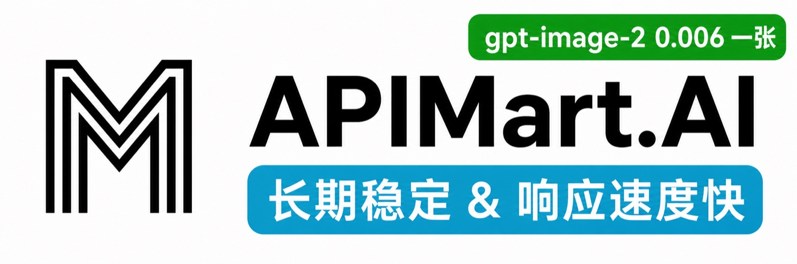
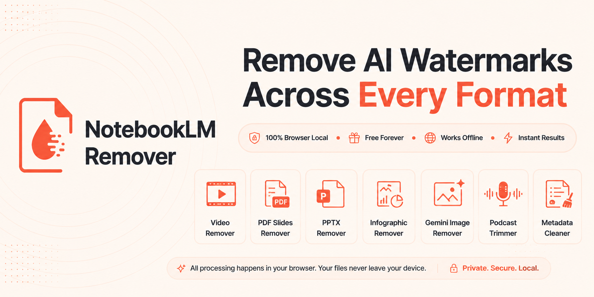

# CCG - Claude Code + GPT + Grok Collaboration

<div align="center">


[](https://github.com/Pyrokine/ccg-workflow)
[](https://github.com/Pyrokine/ccg-workflow/actions/workflows/ci.yml)
[](https://github.com/Pyrokine/ccg-workflow/releases)
[](https://opensource.org/licenses/MIT)
[](https://claude.ai/code)
[](#)

[简体中文](./README.zh-CN.md) | English

</div>

## ♥️ Sponsor

[](https://www.packyapi.ai/register?aff=m21P)

[PackyCode](https://www.packyapi.ai/register?aff=m21P) provides dedicated Claude Code and Codex routes through one domain
and API key. The installer can configure Claude Code and register its Codex provider without changing the active provider.

---

[](https://go.apimart.ai/gh-ccg-workflow)

[APIMart](https://go.apimart.ai/gh-ccg-workflow) sponsors this project and provides image, video, Claude, and GPT APIs.
The installer can configure its Anthropic-compatible endpoint for Claude Code and register its Codex provider. Codex
activation remains an explicit choice.

---

[](https://x6.ai)

[x6.ai](https://x6.ai) provides Claude-compatible and Codex Responses endpoints. The installer registers its Codex provider without changing the active provider; activation requires an explicit choice.

---

[](https://notebooklmremover.org)

[NotebookLM Remover](https://notebooklmremover.org) — Free browser-local AI watermark remover. Remove NotebookLM
watermarks across video, PDF, PPTX, infographic, podcast, and more. 100% private, works offline.

---

## CCG for DeepSeek Harness: `dsh-ccg`

The bundled `dsh-ccg` plugin brings the same role matrix to
[DeepSeek Harness](https://github.com/deepseek-ai/deepseek-harness). It uses the configured `DSH_HOME`, copies the plugin
to a durable local path, and updates only the selected profile manifests.

```bash
node bin/ccg.mjs dsh install                # Install into every discovered profile
node bin/ccg.mjs dsh install --profile web  # Install into one profile
node bin/ccg.mjs dsh list
node bin/ccg.mjs dsh uninstall
```

See [`dsh-ccg/README.md`](./dsh-ccg/README.md) for its role tools, model panels, and persistent teammates.

---

CCG is a workflow engine for Claude Code. Its default frontend, backend, and review routes use independent Claude Code Agents.
Codex, Antigravity, Grok, Kimi Code, OpenCode, and GPT/Grok external review run only when explicitly requested.

Gemini CLI is disabled because consumer OAuth requests stopped being processed after 2026-06-18. Legacy Gemini routes migrate to Grok; `agy` remains an Antigravity alias.

## What's new in v3.7.3-aug.1

- Native Skills support per-host selection, updates, and removal. Empty selections survive reinstallation and routing changes; explicit legacy mode retains the bundled layout.
- `doctor --json` reports mode, primary CLIs, native Skills, six Hook scripts and five events, Codex runtime completeness, and current-session tasks. Version comparison stays local.
- OpenCode setup validates `provider/model`. Core install failures stop init with a nonzero status; optional wrapper and command-generation warnings remain non-fatal.
- x6.ai joins the sponsor registry. `dsh-ccg` 0.5.0 supports DeepSeek Harness `>=0.2.0-rc.2 <0.2.1-0 || >=0.2.1-alpha.2 <0.2.2-0`, with profile settings, activation, persistent subagents, and Windows launcher handling.
- Quality scanners cover files and directories and report missing or unreadable targets. Hooks handle delayed stdin and treat task documents as references under the current explicit user request.

### Retained fork behavior

- Package tarballs use an explicit skills whitelist and exclude `templates/skills/domains/security/`; the red-team and pentest reference notes remain available in Git and are still omitted from default installation.
- PackyCode joins APIMart in a shared sponsor registry used by init, the API menu, Codex mode, and uninstall.
- Codex mode merges one managed block into an existing `~/.codex/AGENTS.md`, preserves user Hooks while registering one
  `UserPromptSubmit` command, creates a pre-install backup, and rolls back every target when installation fails. Its
  ownership manifest restores pre-existing same-name runtime files and leaves later user edits untouched during uninstall.
- Sponsor Codex providers are additive, never overwrite existing provider tables or authentication, preserve config file
  permissions, and activate only after an explicit choice. Uninstall removes only provider tables added by that Codex-mode
  installation. Current stable Codex Hook and multi-agent defaults are retained instead of forcing obsolete
  `multi_agent_v2` timeout tables.
- GPT review remains `gpt-5.6-sol / xhigh`; Grok review now defaults to `grok-4.6 / high`, with exact `grok-4.5` defaults
  migrated during install.
- Claude Code can install the skills bundle from this repository as a native plugin. The complete multi-model workflow
  remains available through the installer.
- `bt-panel`, `seo-page-builder`, and `adsense-site-auditor` add focused web operations workflows.
- `frontend-design` is the single direct design entry and uses 20 Impeccable playbooks internally.
- `dsh-ccg` installs the role matrix into DeepSeek Harness profiles and respects `DSH_HOME`.
- Codex sub-agents skip MCP startup by default. `/ccg:codex-exec` opts in only for retrieval-capable executor calls.
- The task controller refreshes exact specification authority on every user prompt and after foreground external results.

## What's new in v3.0

v3.0 is a ground-up rewrite. One command replaces 29.

- `/ccg:go` — Describe what you want in plain language. The engine analyzes your intent, picks the right strategy, and
  executes it.
- **Hook engine** — User prompts receive a bounded task breadcrumb. Startup, resume, clear, and compact restore the current session's complete task contract, artifacts, and exact linked spec sections; fork starts with a new unbound session identity.
- **Task persistence** — Each worktree stores shared tasks plus opaque per-session bindings. Durable task status remains `open`, `completed`, or `cancelled`; an open task claimed by the current session is exposed as `in_progress`. State, binding, and task revisions reject stale concurrent writes.
- **Agent Teams** — Large tasks spawn parallel Builder teammates via TeamCreate. Each Builder gets isolated file
  ownership.
- **Quality gates** — `ccg:verify-security`, `ccg:verify-quality`, `ccg:verify-change` run as Skill invocations inside strategy
  verification phases.
- **Domain knowledge hooks** — When your message mentions security, caching, RAG, etc., the relevant knowledge file is
  auto-injected into context.
- **Model routing** — Frontend and backend default to independent Claude Code Agents. Codex, Antigravity, Grok, Kimi Code, and OpenCode run only when explicitly selected; Grok, Kimi Code, and OpenCode CLI routes can each use an optional model name.
- **Cross-model review** — Explicit GPT, Grok, dual-model review, and `/ccg:spec-review` use the configured Claude Code provider in separate non-persistent print sessions. `routing.review.profiles` configures their provider-side model and effort independently of the Grok CLI route.
- **Pure Claude Code mode** — This is the default. Independent Claude Code Agents or Agent Teams handle frontend, backend, and review work without wrapper calls.
- **Codex-Led Mode** — Use Codex CLI as the lead orchestrator only when explicitly selected. Install via menu option `X`.

## Quick Start

```bash
git clone https://github.com/Pyrokine/ccg-workflow.git
cd ccg-workflow
corepack enable
pnpm install --frozen-lockfile
pnpm build
node bin/ccg.mjs
```

Requires Node.js 22.13+ or 24.19.0+ and Claude Code CLI. Codex CLI, Antigravity CLI, Grok CLI, Kimi Code CLI, and OpenCode CLI are optional for frontend and backend routing.

The installer walks through API configuration, model routing, MCP tools, and performance/Skills selection.

## How it works

```
You: /ccg:go add JWT authentication to this API

CCG Engine:
  1. Reads project context (git status, tech stack, file structure)
  2. Classifies: feature / L complexity / backend / high risk
  3. Selects strategy: full-collaborate
  4. Creates .ccg/state.json + a session binding + .ccg/tasks/add-jwt-auth/
  5. Writes the complete requirements contract and links exact tracked spec sections
  6. Launches independent Claude Code analysis Agents when both perspectives apply
  7. Produces plan → HARD STOP for your approval
  8. Spawns Agent Teams Builders with task ID, revision, file scope, and authoritative specs
  9. Runs quality gates + an independent Claude Code review, then records the final checkpoint

External CLI routes and GPT/Grok cross-review run only when explicitly requested.

Every turn, a hook injects:
  <ccg-state>
  Task: add-jwt-auth [add-jwt-auth]
  Status: in_progress
  Strategy: full-collaborate
  Phase: 4-implementation
  Next: Layer 1 Builders executing
  Revision: state=3, binding=1, task=7
  </ccg-state>
```

## Strategies

The engine picks a strategy based on task type and complexity:

| Strategy          | When                           | External models      | Teams |
| ----------------- | ------------------------------ | -------------------- | ----- |
| direct-fix        | Simple bug, single file        | No                   | No    |
| quick-implement   | Small feature, clear scope     | No                   | No    |
| guided-develop    | Medium feature, needs planning | Explicit route only  | No    |
| full-collaborate  | Complex feature, multi-module  | Explicit route only  | Yes   |
| debug-investigate | Complex bug, unknown cause     | Explicit route only  | No    |
| refactor-safely   | Code restructuring             | Explicit review only | No    |
| deep-research     | Technical research, comparison | Explicit route only  | No    |
| optimize-measure  | Performance optimization       | Optional             | No    |
| review-audit      | Code review                    | Explicit review only | No    |
| git-action        | commit, rollback, branches     | No                   | No    |

Simple tasks run fast with no overhead. Complex tasks get the full engine.

## Commands

v3.0 installs 12 core commands by default. Legacy mode adds 18 more.

### Core

| Command   | Description                                                   |
| --------- | ------------------------------------------------------------- |
| `/ccg:go` | Smart entry — describe what you want, engine handles the rest |

### Git

| Command               | Description               |
| --------------------- | ------------------------- |
| `/ccg:commit`         | Smart conventional commit |
| `/ccg:rollback`       | Interactive rollback      |
| `/ccg:clean-branches` | Clean merged branches     |
| `/ccg:worktree`       | Worktree management       |

### Project

| Command        | Description                  |
| -------------- | ---------------------------- |
| `/ccg:init`    | Initialize project CLAUDE.md |
| `/ccg:context` | Project context management   |

### OpenSpec

| Command              | Description                      |
| -------------------- | -------------------------------- |
| `/ccg:spec-init`     | Initialize OPSX environment      |
| `/ccg:spec-research` | Requirements → constraints       |
| `/ccg:spec-plan`     | Constraints → zero-decision plan |
| `/ccg:spec-impl`     | Execute plan + archive           |
| `/ccg:spec-review`   | GPT/Grok cross-review            |

## Hook Engine

CCG installs a CommonJS Hook runtime and registers four handler scripts across five Hook event types in
`~/.claude/settings.json`:

| Hook                  | Event                                                   | Purpose                                                                                   |
| --------------------- | ------------------------------------------------------- | ----------------------------------------------------------------------------------------- |
| `workflow-state.js`   | `UserPromptSubmit`, `PostToolUse`, `PostToolUseFailure` | Refresh exact authority on every prompt and after foreground external results             |
| `session-start.js`    | `SessionStart`                                          | Restore the full task snapshot on startup, resume, clear, compact, and fork               |
| `subagent-context.js` | `PreToolUse` for Bash/Agent                             | Modify the actual Agent prompt or wrapper heredoc with role-matched task and spec context |
| `skill-router.js`     | `UserPromptSubmit`                                      | Inject matching domain knowledge                                                          |

`SessionStart` derives an opaque key from the Claude Code `session_id` and exports it through `CLAUDE_ENV_FILE`. Every controller call and authority refresh uses that key. Agent prompts and wrapper heredocs inherit the parent Claude session binding; raw session IDs are not written to state, binding, or turn files.

`task-state.js` is the only task lifecycle writer. Hook input, task files, and spec sections are size-bounded. Invalid task state, missing or oversized authoritative context, and quoted heredocs that cannot be bound to the wrapper command make the `PreToolUse` Hook return `permissionDecision: "deny"`, so the Agent or wrapper does not start without its task contract.

## Task System

Persistent strategies use shared worktree tasks and session-scoped active bindings:

```text
.ccg/
├── state.json                    # stateId and shared structure revision; no active pointer
├── sessions/
│   └── claude-<sha256>.json      # this session's activeTaskId and binding revision
├── state.lock                    # short-lived mutation lock
├── transaction.json             # present only while a multi-file mutation needs recovery
├── tasks/
│   └── add-jwt-auth/
│       ├── task.json             # open/completed/cancelled, task revision, phase, gate, specRefs
│       ├── requirements.md       # required task contract
│       ├── progress.md           # latest successful checkpoint and next action
│       ├── analysis.md           # optional analysis
│       ├── plan.md               # optional approved plan
│       ├── review.md             # optional review result
│       └── research/             # optional research artifacts
├── migrations/                   # byte-preserving state and legacy-task backups
└── historical-artifacts/orphans/ # reversible quarantine for directories without task.json
```

Task files persist only `open`, `completed`, or `cancelled`. When the current session binding points to an open task, the resolver reports effective `in_progress`; other open tasks are `suspended`. One open task is claimed by one session by default, including its open `returnToTaskId` chain. Selecting a claimed task returns `TASK_CLAIMED`; only an explicit takeover transfers the binding. Finishing or recovering a task updates only the calling session's binding. State, binding, and task compare-and-swap revisions reject stale writes, and multi-file updates keep a replayable transaction marker until every atomic replacement succeeds.

When a session has no binding but open tasks remain, the controller returns candidate metadata and requires explicit selection. It does not expose another session key or inject another task's requirements, specifications, or artifacts. This is task-routing isolation, not a filesystem secrecy boundary for processes running as the same operating-system user.

Schema v1 state, legacy tasks, evidenced invalid statuses, and orphan directories use separate explicit migration, repair, and quarantine operations. A former global pointer is retained only as a selection hint and is never assigned automatically. Unfinished legacy tasks remain open, while orphan directories are renamed without reading or classifying their contents. Runtime parent paths must remain ordinary directories inside the worktree; symbolic links are rejected. Branch names and directory timestamps are diagnostic data, never task selectors.

## Specification authority

A task links tracked or staged Markdown sections through structured `specRefs`:

```json
{
  "path": "docs/integration-version-map.md",
  "section": "Merge and dependency rules",
  "purpose": "Defines which repositories merge and which are referenced",
  "roles": ["research", "implement", "review", "debug"]
}
```

The Hook validates the project-relative path, regular-file status, literal Git tracking, unique exact heading outside fenced code blocks, complete bounded section, aggregate context budget, role, and project-root containment. Exact spec sections and `requirements.md` are rendered before optional task artifacts, so the final 32 KiB bound cannot discard the authoritative sources. Broad directory scans and implicit `.ccg/spec/` templates are not used.

The current explicit user request determines execution scope. Linked spec sections and `requirements.md` preserve the task constraints; plans, progress notes, compact summaries, and external-model output are references. When a new request conflicts with those records, update the task scope before continuing. After compact/resume and external-model returns, the lead re-resolves state and checks entities, versions, dependency direction, exclusions, and acceptance criteria.

## Local and shared context

| Location                                  | Scope                                                   |
| ----------------------------------------- | ------------------------------------------------------- |
| `.ccg/`                                   | Local runtime for this worktree; ignored by Git         |
| `.context/current/`                       | Local session notes; ignored by Git                     |
| `.context/prefs/` and `.context/history/` | Tracked team conventions and sanitized decision history |
| Project docs and OpenSpec                 | Tracked shared specifications linked by exact section   |

## Skills bundle

Select native entries independently for Claude Code and Codex after building this checkout:

```bash
node bin/ccg.mjs skills catalog --json
node bin/ccg.mjs skills install verify-quality verify-change
node bin/ccg.mjs skills install verify-quality --target codex
node bin/ccg.mjs skills list --installed --json
node bin/ccg.mjs skills update
node bin/ccg.mjs skills remove verify-quality
node bin/ccg.mjs init --skills none --skip-prompt --skip-mcp
node bin/ccg.mjs doctor --json
```

Menu `S` offers host selection and checkboxes. Claude entries live in `~/.claude/skills/ccg-*`; Codex entries live in `~/.agents/skills/ccg-*`. Each host owns a manifest and versioned resource snapshots outside discovery directories. Updates replace managed links; removals retain snapshots and unrelated user skills. Modified links or snapshots produce an error instead of being overwritten.

Native mode loads selected `/ccg-<name>` skills on demand and disables legacy keyword knowledge injection. `--skills none` selects none, `--skills all` selects the catalog, and a comma-separated list selects named entries. With no native selection configured, init keeps the legacy bundle; explicit legacy mode takes precedence over an old native manifest. The repository plugin keeps its `/ccg:<name>` namespace and bundled catalog.

### Quality checks

`verify-quality` entries request `--language-checks`: project-local ESLint and TypeScript, installed Ruff, or clang-tidy with an existing compilation database. Reports list the tools and files actually checked; missing tools, excluded inputs, configuration failures and timeouts remain incomplete. Direct script calls without that flag retain text-only checks.

Function limits are 10 for complexity, 50 code lines and 5 parameters. Vitest `describe` and `suite` containers are recognized through their imported bindings and scope; individual tests, production functions and shadowed calls keep the same limits.

Quality and security reports compare built-in findings with Git `HEAD`, or an explicit `--base` revision. They separate new and existing findings, leave external diagnostics unclassified when no matching baseline was measured, and keep existing blocking issues in the result. Change analysis uses the nearest module's existing documentation and excludes test-only changes from implementation-document reminders.

The legacy installer and Claude Code plugin provide these direct entries:

| Skill                       | Purpose                                                              |
| --------------------------- | -------------------------------------------------------------------- |
| `/ccg:frontend-design`      | Frontend design entry with 20 internal Impeccable playbooks          |
| `/ccg:bt-panel`             | Deploy and manage sites through the BaoTa/aaPanel HTTP API           |
| `/ccg:seo-page-builder`     | Create and audit SEO tool pages with a runnable on-page audit script |
| `/ccg:adsense-site-auditor` | Check AdSense application readiness and policy requirements          |

Install only the skills bundle from this repository:

```bash
claude plugin marketplace add Pyrokine/ccg-workflow
claude plugin install ccg@ccg
```

The native plugin does not install wrapper binaries or placeholder-based workflow commands.

## CLI commands

```bash
node bin/ccg.mjs doctor                   # Environment health check
node bin/ccg.mjs status                   # Installation and active-task overview
node bin/ccg.mjs codex-mode install       # Install Codex-led mode
node bin/ccg.mjs codex-mode uninstall     # Remove Codex-led mode
node bin/ccg.mjs dsh install              # Install dsh-ccg
node bin/ccg.mjs dsh list                 # List DSH profile status
node bin/ccg.mjs dsh uninstall            # Remove dsh-ccg
node bin/ccg.mjs uninstall                # Uninstall CCG
```

## Configuration

```
~/.claude/
├── commands/ccg/          # Slash commands
├── hooks/ccg/             # Task controller, shared utilities, 4 handlers, 5 event types
├── .ccg/
│   ├── config.toml        # Model routing, MCP, performance
│   ├── engine/            # Strategy files + model router
│   └── prompts/           # Expert prompts (codex/antigravity/claude)
├── skills/ccg/            # Quality gates + domain knowledge
└── bin/codeagent-wrapper  # Multi-model execution bridge
```

### Environment Variables

Set in `~/.claude/settings.json` under `"env"`:

| Variable                               | Default  | Description                                                |
| -------------------------------------- | -------- | ---------------------------------------------------------- |
| `CODEX_TIMEOUT`                        | `7200`   | Wrapper timeout (seconds)                                  |
| `CODEAGENT_POST_MESSAGE_DELAY`         | `5`      | Post-completion delay (seconds)                            |
| `APIMART_API_KEY`                      | unset    | API key used when the APIMart Codex provider is selected   |
| `PACKYCODE_API_KEY`                    | unset    | API key used when the PackyCode Codex provider is selected |
| `X6AI_API_KEY`                         | unset    | API key used when the x6.ai Codex provider is selected     |
| `DSH_HOME`                             | `~/.dsh` | DeepSeek Harness home used by `dsh-ccg`                    |
| `CLAUDE_CODE_EXPERIMENTAL_AGENT_TEAMS` | unset    | Set to `1` to enable Agent Teams parallel execution        |

## Update / Uninstall

```bash
git pull --ff-only
pnpm install --frozen-lockfile
pnpm build
node bin/ccg.mjs init --force --skip-prompt --skip-mcp
node bin/ccg.mjs uninstall  # Remove this fork's installed workflows when needed
```

Menu Update refreshes workflows from the current build. Use this checkout to update the fork; the npm `ccg-workflow@latest` package is the upstream distribution.

## Credits

- [fengshao1227/ccg-workflow](https://github.com/fengshao1227/ccg-workflow) — upstream project
- [cexll/myclaude](https://github.com/cexll/myclaude) — codeagent-wrapper inspiration
- [UfoMiao/zcf](https://github.com/UfoMiao/zcf) — Git tools reference
- [mindfold-ai/Trellis](https://github.com/mindfold-ai/Trellis) — Hook-based workflow state patterns
- [ace-tool](https://linux.do/t/topic/1344562) — MCP code retrieval

## Contributors

<!-- readme: contributors -start -->
<table>
<tr>
    <td align="center"><a href="https://github.com/fengshao1227"><br /><sub><b>fengshao1227</b></sub></a></td>
    <td align="center"><a href="https://github.com/SXP-Simon"><br /><sub><b>SXP-Simon</b></sub></a></td>
    <td align="center"><a href="https://github.com/RebornQ"><br /><sub><b>RebornQ</b></sub></a></td>
    <td align="center"><a href="https://github.com/Sakuranda"><br /><sub><b>Sakuranda</b></sub></a></td>
    <td align="center"><a href="https://github.com/Mriris"><br /><sub><b>Mriris</b></sub></a></td>
    <td align="center"><a href="https://github.com/23q3"><br /><sub><b>23q3</b></sub></a></td>
    <td align="center"><a href="https://github.com/MrNine-666"><br /><sub><b>MrNine-666</b></sub></a></td>
</tr>
<tr>
    <td align="center"><a href="https://github.com/GGzili"><br /><sub><b>GGzili</b></sub></a></td>
</tr>
</table>
<!-- readme: contributors -end -->

## Project links

- [Issues](https://github.com/Pyrokine/ccg-workflow/issues)
- [Releases](https://github.com/Pyrokine/ccg-workflow/releases)
- [Upstream](https://github.com/fengshao1227/ccg-workflow)

## Star History

[](https://www.star-history.com/#Pyrokine/ccg-workflow&type=timeline&legend=top-left)

## License

MIT

---

v3.7.3-aug.1 | [Issues](https://github.com/Pyrokine/ccg-workflow/issues) | [Contributing](./CONTRIBUTING.md) | [Releasing](./RELEASING.md)
